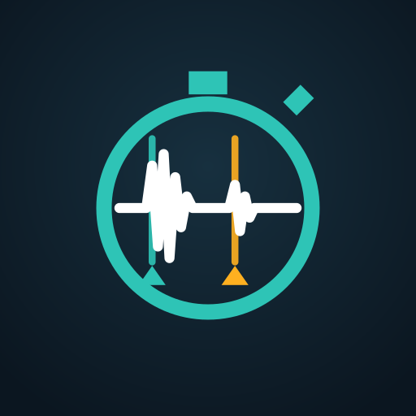

# Chroni — chronographe acoustique Android



Chroni estime la **vitesse** et l'**énergie cinétique** d'un projectile en écoutant, avec le micro du téléphone, le bruit du départ puis celui de l'impact sur une cible sonore. Application personnelle, 100 % hors ligne, sans publicité ni télémétrie. Seule autorisation : le microphone.

> Résultat expérimental, non certifié. Voir « Limites » ci-dessous.

## Installation (Pixel 6a ou autre Android 8+)
1. Télécharger `Chroni-1.0.0-debug.apk` depuis la page **Releases** du dépôt GitHub (ou `livrables/` dans le dossier local) et le copier sur le téléphone.
2. L'ouvrir depuis l'application Fichiers ; autoriser « Installer des applications inconnues » pour l'appli utilisée si Android le demande.
3. Lancer **Chroni** depuis le lanceur ; accepter l'accès au micro à la première mesure.

## Utilisation
1. Saisir la **masse** (g), la **distance bouche → cible** (m) et, si possible, la **température** (°C ; sinon 20 °C nominal).
2. Poser le téléphone **près du tireur, idéalement juste derrière la bouche, dans l'axe du tir**.
3. Appuyer sur **Lancer une mesure**, attendre **« Prêt »** (≈ 0,6 s de bruit ambiant), tirer.
4. L'enregistrement s'arrête seul après la fenêtre de recherche de l'impact (ou bouton **Arrêter**).
5. L'écran **Résultat** affiche vitesse, énergie, délai brut, temps de vol, retour du son, qualité et avertissements.
6. **Graphique acoustique / corriger** : vérifier ou déplacer les repères D (départ, cyan) et I (impact, ambre) :
   - glisser une poignée D/I pour la déplacer (la précision suit le zoom, jusqu'à 1/8 d'échantillon par pixel) ;
   - glisser ailleurs pour défiler, pincer ou boutons loupe pour zoomer, double-toucher pour zoomer ×2 ;
   - boutons −1 ms / −1 éch. / +1 éch. / +1 ms pour le réglage fin ;
   - liste « Pics détectés » ou triangles en bas du graphique : placer le repère sur un pic précis ;
   - « dB » : échelle logarithmique pour voir un impact faible ; « Auto » : revenir aux positions détectées ;
   - **Confirmer et enregistrer** : sauvegarde (les positions automatiques d'origine restent conservées).
7. **Historique** : toutes les mesures (auto / corrigée), réouverture, suppression.

## Premiers essais conseillés (check-list)
- [ ] L'icône Chroni (chronomètre + onde) apparaît dans le lanceur, et l'écran de lancement bleu nuit s'affiche.
- [ ] Mesure « à blanc » : saisir 10 m, lancer, attendre « Prêt », claquer des mains près du téléphone puis frapper une casserole à quelques mètres : deux événements doivent être détectés et visibles dans le graphique.
- [ ] Rouvrir la mesure depuis l'historique, déplacer un repère, confirmer, vérifier « Corrigée ».
- [ ] Mettre l'appli en arrière-plan pendant un enregistrement : elle doit s'arrêter proprement.
- [ ] Tirs réels sur cible métallique, si possible à côté d'un chronographe de référence : noter les écarts.

## Modèle physique
Δt = D/v + D/c  ⇒  v = D / (Δt − D/c), avec c = 331,3 × √(1 + T/273,15) m/s ; E = ½ m v² (m en kg).
Le temps est compté en **échantillons audio** (48 000/s), pas avec l'horloge du téléphone.

## Limites de précision
- Téléphone supposé près de la bouche ; derrière le tireur dans l'axe, l'écart s'annule exactement ; **sur le côté, chaque mètre d'écart latéral fausse le délai d'environ 2,8 ms** (≈ 3 % à 100 m/s sur 10 m).
- Erreur relative sur v ≈ erreur relative sur D (10 cm sur 10 m → 1 %).
- 0,1 ms d'erreur sur Δt → ≈ v²/D × 10⁻⁴ m/s (1 m/s à 100 m/s sur 10 m) : plus la distance est grande, meilleure est la mesure.
- Projectile supersonique : onde de choc possible, résultat moins fiable (avertissement affiché).
- Échos et bruits parasites : vérifier le graphique quand la qualité n'est pas « bonne ».
- Aucune validation sur tir réel à ce jour (voir `TEST_PLAN.md`).

## Compilation
Voir `CLAUDE.md` §8. Résumé : JDK 17+, Android SDK 36, puis
`./gradlew :app:testDebugUnitTest :app:assembleDebug` → `app/build/outputs/apk/debug/app-debug.apk`.

## Signature de la version release (avec ta propre clé)
La release est livrée **non signée** (`livrables/Chroni-1.0.0-release-unsigned.apk`) : aucune clé n'a été inventée. Pour la signer (une seule fois, garder la clé précieusement) :
```
keytool -genkeypair -v -keystore chroni.jks -alias chroni -keyalg RSA -keysize 4096 -validity 10000
zipalign -p 4 Chroni-1.0.0-release-unsigned.apk Chroni-aligned.apk
apksigner sign --ks chroni.jks --out Chroni-1.0.0-release.apk Chroni-aligned.apk
apksigner verify Chroni-1.0.0-release.apk
```
(`zipalign` et `apksigner` sont dans `build-tools` du SDK Android.) Attention : une APK signée avec une autre clé que la debug ne peut pas mettre à jour la version debug installée — désinstaller d'abord (l'historique sera effacé).

## Documents
`PROJECT_STATUS.md` (état), `TECHNICAL_NOTES.md` (architecture, détection), `TEST_PLAN.md` (tests), `docs/SUIVI.md`, `docs/DECISIONS.md`, `docs/screenshots/` (captures générées par les tests).

## Licence
MIT — voir `LICENSE`.
